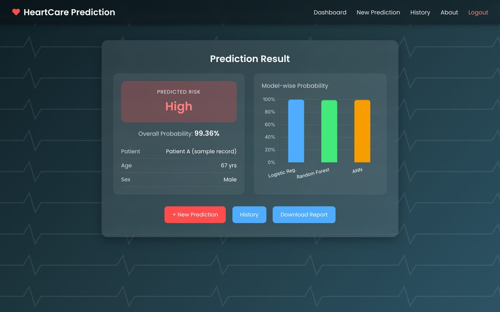
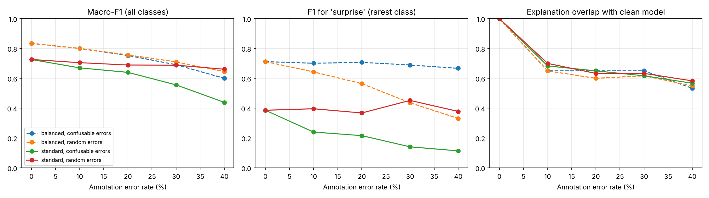

# Rizwan Ali

**AI Engineer · Machine Learning · Deep Learning · NLP · LLMs & AI Agents · Chatbots · Explainable AI · Python**

**Portfolio website: https://rizwannazir333.github.io/portfolio-rizwan/**

Software Engineering graduate and AI Engineer Intern at TechGeneyes. I build and evaluate machine learning models that are reliable, explainable and useful in the real world, and I am seeking a Master's degree to research trustworthy AI across machine learning, NLP and computer vision.

BS Hons Software Engineering · CGPA 3.66 / 4.00 · Abu Dhabi, UAE · Master's 2027: AI · Machine Learning · Computer Science

[Academic CV (PDF)](assets/Rizwan_Ali_CV_Photo.pdf) · [Europass CV (PDF)](assets/Rizwan_Ali_Europass_CV_Photo.pdf) · [LinkedIn](https://linkedin.com/in/rizwan-ali-ai-engineer) · [GitHub](https://github.com/rizwannazir333) · rizwan_nazir@163.com

## Projects

### [Heart Disease Risk Prediction Using Machine Learning and Deep Learning](https://github.com/rizwannazir333/heart-disease-prediction-final-year-project)

Research project · Final Year Project, BS Hons Software Engineering · Grade A · Jul 2025 – Jul 2026

**[Try the live app](https://rizwannazir333.github.io/portfolio-rizwan/app/)** · [Watch the 16-second demo (MP4)](assets/heartcare_demo.mp4) · [Model card](https://github.com/rizwannazir333/heart-disease-prediction-final-year-project/blob/main/MODEL_CARD.md)

- Compared logistic regression, a random forest and a neural network with dropout (TensorFlow/Keras) on 13 clinical features from 597 patient records, and averaged their probabilities into three risk levels.
- With repeated stratified 5-fold cross-validation, logistic regression and the random forest reached ROC-AUC 0.90 (accuracy 0.82–0.83); recall stayed below precision, the main weakness to address.
- Half the records had missing values; median imputation fitted inside each training fold kept all 597 records, matched the scores of dropping them and roughly halved the variation between folds.
- Measured permutation feature importance on held-out folds; both models ranked major vessels, chest pain type and thalassemia among the strongest predictors.
- Wrote a model card on intended use and limitations; built a Flask and MySQL web app with tests and CI.

### [How Human Feedback Quality Affects NLP Models](https://github.com/rizwannazir333/human-feedback-nlp)

Research project · Independent study, human-centred NLP · Nov 2026

- Trained an explainable emotion classifier (TF-IDF and logistic regression) on 16,000 sentences after corrupting 0–40% of the training labels, at random or by swapping similar emotions, to simulate imperfect annotators.
- At the same 40% error rate, random errors cost 0.07 macro-F1, while errors between similar emotions cost 0.29 (0.73 → 0.44).
- The rarest emotion reached F1 0.39 with standard training; balanced class weights raised it to 0.71 and kept it near 0.67 under heavy label noise.
- With only 10% label errors, about a third of each class's top explanatory words changed, even when accuracy barely moved.

### Local LLM Writing Assistant, built three ways

Software project · Personal project · Nov 2026

**[See recorded runs](https://rizwannazir333.github.io/portfolio-rizwan/llm-demo/)** · [Part 1: Plain Ollama](https://github.com/rizwannazir333/ollama-writing-assistant) · [Part 2: LangChain](https://github.com/rizwannazir333/langchain-writing-assistant) · [Part 3: LangGraph](https://github.com/rizwannazir333/langgraph-writing-assistant)

- Built the same offline email-drafting and grammar-correction assistant with plain Ollama, LangChain and LangGraph on a 4-bit quantized 4B-parameter model, to compare what each framework adds.
- The LangGraph version reviews and corrects its own drafts, calls tools, waits for human approval and processes sentences in parallel with caching.
- Prepared lesson slides that teach LangChain and LangGraph using this project as the running example.

## Education

**BS Hons Software Engineering, Virtual University of Pakistan** · 2023 – 2026

CGPA 3.66 / 4.00 · Final year project: Grade A · Completed August 2026

Relevant courses: Artificial Intelligence, Machine Learning, Data Structures & Algorithms, Database Systems, Software Engineering.

## Research interests

- **Trustworthy and explainable AI:** faithful, stable explanations and well-calibrated predictions that people can rely on
- **Machine learning for healthcare:** risk prediction that holds up across patient groups and hospitals
- **NLP and large language models:** LLM agents, tool use and evaluation; extracting information from text, including clinical notes
- **Computer vision:** image classification and analysis, including medical imaging
- **Data-centric AI:** learning from missing, imbalanced, small or noisy data, and building high-quality annotated datasets
- **Robust evaluation and generalisation:** testing whether models still work beyond their training data, across groups and settings

## Experience

**AI Engineer Intern, TechGeneyes** · Remote · Aug 2026 – Present

- Develop and evaluate machine learning and deep learning models with scikit-learn and TensorFlow/Keras.
- Prepare and explore data, engineer features and tune hyperparameters.
- Report model performance with precision, recall, F1-score and confusion matrices.

## Technical skills

| Area | Skills |
| --- | --- |
| ML methods | Logistic regression, random forests, neural networks, cross-validation, imputation, feature engineering, hyperparameter tuning |
| AI areas | Computer vision, NLP, chatbots, data annotation, explainable AI |
| Evaluation | ROC-AUC, precision, recall, F1-score, confusion matrices, permutation feature importance, model cards |
| ML libraries | scikit-learn, TensorFlow, Keras, Pandas, NumPy, Matplotlib, Seaborn |
| LLMs | Few-shot prompting, structured output, tool-using agents, human-in-the-loop; Ollama, LangChain, LangGraph, Pydantic |
| Software | Python, SQL, Flask, MySQL, Git, GitHub Actions (CI), pytest, Jupyter, Python automation |

## Languages and references

- **English:** B2 (CEFR) in listening, reading, speaking and writing
- **References:** available on request
