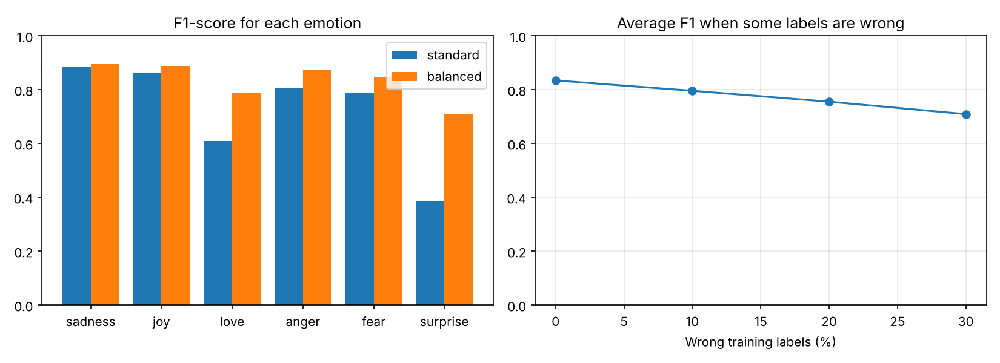

# Emotion Detection from Text

A simple NLP project: a model reads a sentence and predicts the emotion in it
(sadness, joy, love, anger, fear or surprise).

I used it to answer two questions:

1. **Does the model recognise rare emotions as well as common ones?**
2. **What happens to the model when some training labels are wrong?**



## Data

The public [Emotion dataset](https://huggingface.co/datasets/dair-ai/emotion):
16,000 English sentences for training and 2,000 for testing, each labelled with one emotion.

The emotions are not balanced. *Joy* has 5,362 training sentences, but *surprise* has only 572.

## Method

1. **Turn text into numbers with TF-IDF.** Each sentence becomes a list of word scores. A word scores high if it is frequent in the sentence but rare in the dataset.
2. **Train logistic regression.** It learns a weight for every word and emotion, for example "terrified" → *fear*.
3. **Measure with F1-score for each emotion,** not just accuracy, so that weak results on rare emotions are not hidden.
4. **Compare two versions of the model:**
   - *standard*: every sentence counts the same
   - *balanced*: sentences of rare emotions count more during training (`class_weight="balanced"`)
5. **Make some training labels wrong on purpose** (10%, 20%, 30%), retrain, and test on the clean test set.

## Results

| Emotion | Training sentences | F1, standard | F1, balanced |
|---|---|---|---|
| sadness | 4,666 | 0.89 | 0.90 |
| joy | 5,362 | 0.86 | 0.89 |
| love | 1,304 | 0.61 | 0.79 |
| anger | 2,159 | 0.81 | 0.88 |
| fear | 1,937 | 0.79 | 0.85 |
| surprise | 572 | **0.39** | **0.71** |
| **average** | | **0.72** | **0.83** |

| Wrong training labels | 0% | 10% | 20% | 30% |
|---|---|---|---|---|
| Average F1 (balanced model) | 0.83 | 0.80 | 0.76 | 0.71 |

Words the model relies on most (from [`results/results.txt`](results/results.txt)):

- **fear:** shaken, terrified, vulnerable, nervous, paranoid, scared
- **surprise:** amazed, impressed, curious, surprised, shocked
- **joy:** successful, glad, satisfied, pleasant

## What I learned

1. **Rare emotions were the weak point.** The standard model found *surprise* poorly (F1 0.39), even though the average looked fine.
2. **A simple fix helped a lot.** Balanced class weights raised *surprise* from 0.39 to 0.71 and *love* from 0.61 to 0.79.
3. **Wrong labels slowly damage the model.** Each extra 10% of wrong labels cost about 0.04 average F1, so label quality matters.
4. **The model is easy to explain.** Its strongest words for each emotion make sense to a person.

## Limitations

- I made labels wrong at random. Real annotators make more specific mistakes, for example confusing *love* and *joy*.
- One dataset and one simple model. A transformer model would probably score higher but be harder to explain.

## Run it

```bash
pip install -r requirements.txt
python emotion_classifier.py
```

It takes about one minute on a laptop and writes `results/results.txt` and `results/results.png`.

## Author

Rizwan Ali · [Portfolio](https://rizwannazir333.github.io/portfolio-rizwan/) · [GitHub](https://github.com/rizwannazir333) · November 2026
