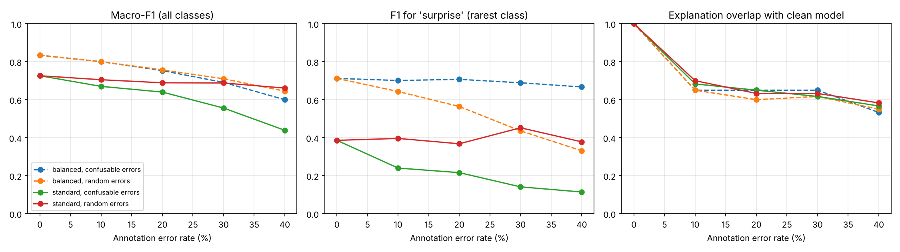

# How Human Feedback Quality Affects NLP Models

A small, reproducible study of a question at the centre of human-centred NLP:
**when the people who label data make mistakes, what happens to the model, to rare classes, and to the model's explanations?**

I train an explainable text classifier on the public
[Emotion dataset](https://huggingface.co/datasets/dair-ai/emotion)
(16,000 English sentences, 6 emotions) after deliberately corrupting a share of the training labels,
and evaluate it on the clean test set.



## Why this matters

Models learn from human annotations, and those annotations are never perfect.
The dataset is also imbalanced: *joy* has 5,362 training examples, *surprise* only 572.
I wanted to see whether overall scores hide damage to the rare classes (I saw this in my
heart disease project), and whether explanations stay trustworthy when the feedback is noisy.

## Setup

| Part | Choice |
|---|---|
| Model | TF-IDF (1–2 grams) + logistic regression, chosen because its explanations (word weights) are exact |
| Feedback errors | **random**: wrong label picked at random (careless annotator) · **confusable**: label swapped for a similar emotion, e.g. *surprise → joy*, *fear → sadness* (realistic annotator disagreement) |
| Error rates | 0%, 10%, 20%, 30%, 40% of training labels |
| Imbalance handling | standard training vs. **balanced** class weights (cost-sensitive learning) |
| Metrics | macro-F1, per-class F1, and **explanation overlap**: share of each class's top-10 words that stay the same as in the model trained on clean labels |

## Results

| Model | Errors | Error rate | Macro-F1 | *Surprise* F1 | Explanation overlap |
|---|---|---|---|---|---|
| standard | none | 0% | 0.726 | 0.386 | 1.00 |
| standard | random | 40% | 0.661 | 0.378 | 0.58 |
| standard | confusable | 40% | 0.439 | 0.114 | 0.57 |
| balanced | none | 0% | **0.834** | **0.712** | 1.00 |
| balanced | random | 40% | 0.645 | 0.331 | 0.55 |
| balanced | confusable | 40% | 0.600 | 0.667 | 0.53 |

Full results for every setting are in [`results/results.csv`](results/results.csv).

## What I learned

1. **The type of error matters more than the amount.** Random errors at 40% cost the standard model 0.07 macro-F1;
   confusable errors at the same rate cost 0.29. Realistic disagreement between similar categories is far more harmful than random noise.
2. **Overall scores hide minority-class failure.** Without class weighting, *surprise* F1 is only 0.39 even with clean labels,
   while macro-F1 looks acceptable. Balanced class weights raise it to 0.71.
3. **Explanations are fragile.** With only 10% label errors, about a third of each class's top explanatory words change,
   even when accuracy barely moves. A model can look equally accurate while giving users different reasons.

## Limitations and next steps

- One dataset, one model, and one random seed. Next: repeat with several seeds and report the variance.
- Label errors are simulated. Next: use datasets that keep every annotator's label (e.g. multi-annotator corpora) to study real disagreement.
- The model is linear. Next: compare with a fine-tuned transformer and post-hoc explanation methods (e.g. SHAP, attention-based).
- Explanations are compared automatically. Next: ask users which explanations they find useful, so that explanations are designed with users.

## Run it

```bash
cd human-feedback-nlp
pip install -r requirements.txt
python src/run_experiment.py
```

The dataset downloads automatically. The run takes about 3–5 minutes on a laptop CPU and writes everything to `results/`.

## Project structure

```
src/
  data.py            load the Emotion dataset
  feedback.py        simulate random and confusable annotation errors
  model.py           TF-IDF + logistic regression, and word-weight explanations
  run_experiment.py  run all settings, save results.csv, top_words.txt and the plot
results/             outputs
```

## Author

Rizwan Ali · [GitHub](https://github.com/rizwannazir333) · [LinkedIn](https://linkedin.com/in/rizwan-ali-ai-engineer) · November 2026
